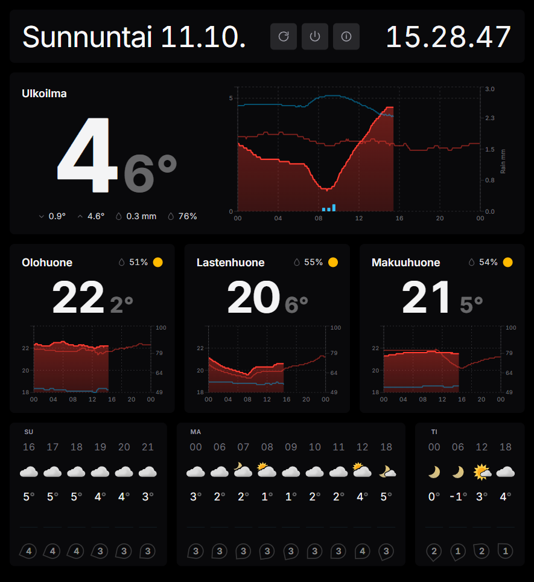

# Netatmo Weather Display

A weather display web application for presenting temperature information gathered by locally installed [Netatmo weather sensors](https://www.netatmo.com/en-eu/weather/weatherstation).

Optionally, readings from an [IKEA TIMMERFLOTTE](https://www.ikea.com/) temperature/humidity sensor (a Matter-over-Thread device) can be displayed alongside the Netatmo data, provided the additional [requirements](#requirements) below are met.

> **Note:** This is a complete rewrite of my earlier [netatmo-weather-display](https://github.com/mikkosiikaniemi/netatmo-weather-display) repository, rebuilt from the ground up with a React + TypeScript frontend and a Node.js + Express backend.


## Screenshot



## Key technologies

- Frontend: React + TypeScript with Vite.
- State/data fetching: React Query + Axios.
- Visualization: Recharts for historical charts.
- Styling: Tailwind CSS (with PostCSS/Autoprefixer) and custom CSS.
- Backend API: Node.js + Express + TypeScript.
- Integrations: Netatmo API (OAuth2 + station data), Yr weather forecast API, and sunrise/sunset calculation based on coordinates. Optional IKEA TIMMERFLOTTE (Matter-over-Thread) temperature/humidity readings via the sensor ingest API.
- Deployment: one-command Bash deployment via `deploy.sh` (builds frontend and backend, then runs the backend that serves static frontend files in production).

## Requirements

1. [Netatmo weather station](https://www.netatmo.com/en-eu/weather/weatherstation) — you will need the [MAC address of the big module](https://helpcenter.netatmo.com/en-us/smart-home-weather-station-and-accessories/product-interactions/how-do-i-find-my-products-serial-number-or-its-mac-address). My setup consists of big module and three additional modules, thus the app is optimized for the amount.
1. [Netatmo connect dev app](https://dev.netatmo.com/apps/createanapp) created (this is needed to authorize fetching the data via Netatmo API) — you will need to make note of the `client ID` and `client secret` under _App Technical Parameters_.
1. Your latitude and longitude for weather forecast by Finnish Meteorological Institute and for sunrise/sunset times — get these by opening [Google Maps](https://www.google.com/maps) on desktop and right-clicking on the map; you can see the coordinates on the top of the popup. 
1. [Node.js](https://nodejs.org/) and npm.
1. _(Optional)_ To display readings from an IKEA TIMMERFLOTTE temperature/humidity sensor:
   - the sensor already paired to your home and reachable by a Thread border router (Apple TV or HomePod), and
   - one of:
     - a **Raspberry Pi 4B** with 64-bit Raspberry Pi OS and Python 3.12+ running the included Matter bridge (see [`matter-bridge/README.md`](matter-bridge/README.md)), or
     - an Apple device running a Shortcuts automation that reads the accessory and pushes to the ingest API.

   The Raspberry Pi path additionally requires IPv6 enabled on the host, no IPv6 forwarding, and all devices (Pi, sensor, border router) on the same flat LAN/VLAN. Full details are in the [bridge prerequisites](matter-bridge/README.md#prerequisites).

## Installation

1. Clone the repository.
1. Copy `backend/.env.example` to `backend/.env` and fill in the required values.
1. Install backend dependencies with `cd backend && npm install`.
1. Install frontend dependencies with `cd frontend && npm install`.

## Local development

From the project root, start both the backend API and frontend app with:

```bash
npm run dev
```

Open the frontend URL shown by Vite (usually `http://localhost:5173`). Press `Ctrl+C` to stop both servers.

## Production builds

1. Build backend with `cd backend && npm run build`.
1. Build frontend with `cd frontend && npm run build`.

## Simplest production deployment (one command)

This project now supports a single command deployment flow that:

1. Installs backend and frontend dependencies.
1. Builds frontend and backend.
1. Starts the backend server, which also serves the built frontend.

Run this from the repository root:

```bash
bash deploy.sh
```

### Required backend environment variables for production

Set these in `backend/.env` on your server:

```env
NODE_ENV=production
PORT=3001
FRONTEND_ORIGIN=https://your-domain.com
SESSION_SECRET=your-long-random-secret
NETATMO_CLIENT_ID=...
NETATMO_CLIENT_SECRET=...
NETATMO_REDIRECT_URI=https://your-domain.com/auth/callback
HISTORY_TIMEZONE=Europe/Helsinki
# Shared token for the sensor ingest API (see "IKEA TIMMERFLOTTE sensor support" below)
SENSOR_INGEST_TOKEN=generate-a-long-random-value
# Optional forecast location override (otherwise first Netatmo station location is used)
# FORECAST_LAT=60.192059
# FORECAST_LON=24.945831
# FORECAST_ALTITUDE=30
```

### Notes

- Keep your process running with a process manager like PM2 or systemd.
- You can place Nginx in front for TLS and domain routing, but the app works with one Node process out of the box.

## IKEA TIMMERFLOTTE sensor support (sensor ingest API)

The app supports the **IKEA TIMMERFLOTTE** temperature/humidity sensor in addition to the Netatmo station. The sensor is a Matter-over-Thread device, so it is read through one of two paths and pushed to the backend's ingest API:

| Path | Requirements | Notes |
| --- | --- | --- |
| **Raspberry Pi Matter bridge** (recommended) | Raspberry Pi 4B, 64-bit OS, Python 3.12+, sensor paired to your home, an Apple TV/HomePod Thread border router on the same LAN | Fully automatic (polls every 10 min). See [`matter-bridge/README.md`](matter-bridge/README.md). |
| **Apple Shortcuts automation** | An Apple device and the sensor already in the Home app | No extra hardware; runs on a time-based automation. See [Apple Shortcuts automation](#apple-shortcuts-automation). |

The ingest endpoint below is common to both paths and can also be used by any other sensor.

### Configuration

Set a shared secret token in `backend/.env` (see `backend/.env.example`):

```env
SENSOR_INGEST_TOKEN=generate-a-long-random-value
```

Generate one with `openssl rand -hex 32`. If the variable is unset, the ingest endpoint returns `503`.

### Endpoints

| Method | Path | Auth | Description |
| --- | --- | --- | --- |
| `POST` | `/api/sensors/ingest` | Token | Store a reading. |
| `GET` | `/api/sensors/readings` | Token or session | All readings from the last 48 hours (optional `?deviceId=`). |
| `GET` | `/api/sensors/latest` | Token or session | The newest reading (optional `?deviceId=`). |

The token is sent either as an `X-Api-Token: <token>` header or as a `?token=<token>` query parameter.

### POST body

`Content-Type: application/json` or form-encoded. All fields are optional, but send at least one measurement:

```json
{
  "temperature": 21.4,
  "humidity": 44,
  "battery": 90,
  "deviceId": "timmerflotte-livingroom",
  "name": "Living room"
}
```

- `temperature`, `humidity`, `battery` are also accepted under aliases (`temp`, `temperatureCelsius`, `relativeHumidity`, `batteryLevel`) and any numeric field is stored verbatim under `values`.
- `deviceId` defaults to `timmerflotte`.
- `timestamp` (epoch seconds or milliseconds) is optional; server receipt time is used otherwise.

Example:

```bash
curl -X POST "https://your-domain.com/api/sensors/ingest" \
  -H "X-Api-Token: $SENSOR_INGEST_TOKEN" \
  -H "Content-Type: application/json" \
  -d '{"temperature":21.4,"humidity":44}'
```

### Apple Shortcuts automation

1. Create a Personal Automation (e.g. time-based) in the Shortcuts app.
2. Add an action to read the sensor value (Home app accessory state) and, if needed, format it to a number.
3. Add **Get contents of URL**:
   - URL: `https://your-domain.com/api/sensors/ingest`
   - Method: `POST`
   - Request body: `JSON` with `{"temperature": [temperature], "humidity": [humidity]}`
   - Headers: `X-Api-Token: <your token>` (or append `?token=<your token>` to the URL).

Readings persist in `backend/data/sensor-readings.json` (gitignored), so history survives restarts.

### Raspberry Pi controller (no Apple Shortcuts needed)

Instead of Apple Shortcuts, a Raspberry Pi can run a Matter controller
([`matter-bridge/`](matter-bridge/README.md)) that reads the TIMMERFLOTTE directly
over Thread (via an Apple TV/HomePod border router) and pushes readings to the same
`/api/sensors/ingest` endpoint. This path is fully automatic; see the
[`matter-bridge` prerequisites](matter-bridge/README.md#prerequisites) for the
required hardware, network, and Thread setup.

## Opalstack one-command updates from local machine

You can deploy directly from your local machine to Opalstack with one command.

Required environment variables:

- `OPALSTACK_SSH`, for example `user@example.opalstack.com`
- `OPALSTACK_APP_ROOT`, for example `/home/user/apps/netatmo`

Optional environment variables:

- `OPALSTACK_PROJECT_DIR` (default is `<OPALSTACK_APP_ROOT>/<local-repo-folder>`)
- `OPALSTACK_NODE_SCL` (default is `nodejs20`)

Run from repository root:

```bash
OPALSTACK_SSH=user@example.opalstack.com \
OPALSTACK_APP_ROOT=/home/user/apps/netatmo \
bash deploy.sh
```

Or create a local deploy env file:

1. Copy `/.env.deploy.example` to `/.env.deploy`.
1. Fill in your Opalstack values.
1. Run:

```bash
./deploy.sh
```

You can also point to a custom file path:

```bash
DEPLOY_ENV_FILE=/path/to/custom.deploy.env ./deploy.sh
```

The script will:

1. Sync this repository to Opalstack using `rsync`.
1. Preserve `backend/.env` on the server.
1. Install frontend and backend dependencies on Opalstack.
1. Build frontend and backend on Opalstack.
1. Restart the app via Opalstack `stop` and `start` scripts when available.

## Credits

Weather forecast from [Norwegian Meteorological Institute's developer API](https://developer.yr.no/doc/GettingStarted/).

Icons from [Feather Icons](https://feathericons.com/). Weather symbols from [Yr](https://nrkno.github.io/yr-weather-symbols/).

## Design assets

- Source design files that are not served by the app are stored under `design/`.
- Favicon source file: `design/favicon/apple-touch-icon.ai`.
- Runtime favicon file served by Vite: `frontend/public/apple-touch-icon.png`.
